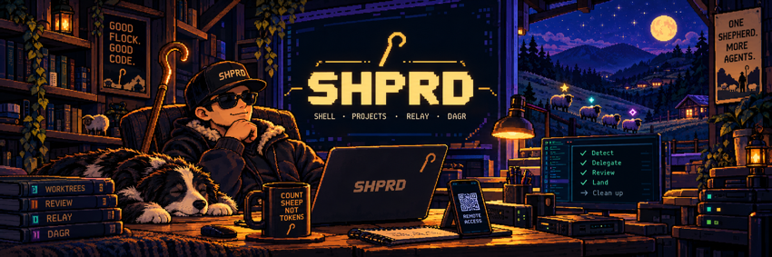

<h1> shprd</h1>

A shepherd for your coding agents, right in the terminal.

<p align="center">
  
</p>

**shprd** (*shepherd*; **SH**ell for **P**rojects, **R**elay and **D**agr) runs a
flock of coding agents on one repo. One orchestrator plans and delegates. Workers
from different vendors build in isolated git worktrees. A reviewer from another
vendor judges the work. Then shprd lands it as one pull request and cleans up
after itself.

It runs inside [herdr](https://herdr.dev) or [tuios](https://github.com/Gaurav-Gosain/tuios),
uses the agent CLIs you already have, and lets you watch and steer the whole run
from your phone.

[](#status)
[](https://herdr.dev)
[](https://github.com/Gaurav-Gosain/tuios)
[](LICENSE)

```
shprd setup               # once per machine: pick your agents, models and skills
cd ~/projects/your-repo
shprd up                  # start the run: chat, orchestrator, task graph
```

> **Status:** design is done, code is not. Nothing above runs yet. This README
> describes what shprd is being built to do; [Status](#status) says what exists.

---

## Why this exists

Multi-agent coding works. Setting it up is the hard part. Wiring several agent
CLIs, their models, their skills, a reviewer, worktrees, merge rules and remote
access by hand is a weekend, and every new teammate repeats it.

shprd's bet is that most of that can be detected instead of configured, and the
rest decided once in a TUI:

- **Any CLI, no setup marathon.** `shprd setup` finds the agent CLIs on your
  machine and checks they're signed in. You star one as the orchestrator, then
  pick models and skills per role.
- **A flock, not a pile.** Every task gets its own git worktree and its own tab.
  A live task graph ([dagr](https://github.com/aemrebarut/herdr-dagr)) shows who
  is doing what, what was sent back, and why.
- **Strays come back fast.** When an agent runs out of quota or goes silent,
  shprd notices within minutes, checkpoints its work and hands the task to the
  next agent in line, in the same worktree.
- **Review you can trust.** The reviewer is a different vendor than the
  implementers, and whether work passes is decided by rules, not by a model's
  mood.
- **It tidies up.** shprd only touches the branches, worktrees and tabs it
  created. It archives before it deletes, and it asks you only about things it
  doesn't own.
- **Your phone is a remote.** Approve, steer and read diffs from anywhere
  through [herdr-mobile-relay](https://github.com/0cv/herdr-mobile-relay) on
  herdr, or tuios's own web and SSH access on tuios.

## How it works

```
 you ──► shprd·chat ──types into──► ★ orchestrator CLI ──shprd agent …──► engine
            ▲                                                              │
            │ reads its conversation          spawns, watches, hands off   │
            └──────────────────────────────── ● workers  ◇ reviewer ◄─────┘
                                                   │
 phone ◄── relay / tuios-web          events.jsonl ──► dagr view · brief · PR body
```

- **The engine owns the truth.** Every action is an event in an append-only
  log. The task graph, the rehydration brief, the PR body and phone cards are
  all rendered from that log by code. No agent hand-writes status.
- **The orchestrator is a real CLI.** It runs in its own tab where you, the mux
  and the phone can all see it. `shprd·chat` is a nicer window onto the same
  conversation.
- **Agents only act through verbs.** `shprd agent task|spawn|gate|report|escalate`.
  The engine checks each one, so an illegal move (integrating past a failed
  review) is refused, not just discouraged.

### Roles

| Symbol | Role | Does |
|---|---|---|
| ★ | **Orchestrator** | plans, splits work into tasks, routes skills, talks to you |
| ● | **Worker** | implements one task in its own worktree, runs the repo's checks |
| ◇ | **Reviewer** | reviews the diff against the task's acceptance criteria; never edits |
| ◌ | (state) | an agent that is out of quota or waiting |

Integration, landing and cleanup are not roles. They're deterministic steps the
engine runs itself.

## What it looks like

One workspace per repo. Tab names say who is in them:

```
shprd·chat │ ★ claude·orchestrator │ ● pi·middleware │ ● kilo·docs │ ◇ codex·middleware
```

`shprd·chat` holds the chat on the left, the task graph on the right, and a
remote-access box under it. The invite QR stays hidden until you ask, because
it's a one-use credential.

## Supported agents

First release targets these five. Each is detected, signed-in-checked and
launched the way its own CLI expects:

| CLI | Can orchestrate | Can work | Can review | Quota visible before dispatch |
|---|---|---|---|---|
| Claude Code (`claude`) | ✓ | ✓ | ✓ | expected (to be confirmed) |
| Codex (`codex`) | ✓ | ✓ | ✓ | ✓ |
| OpenCode (`opencode`) | ✓ | ✓ | ✓ | no; watched on screen |
| Kilo (`kilo`) | ✓ | ✓ | ✓ | no; watched on screen |
| Pi (`pi`) | ✓ | ✓ | ✓ | no; watched on screen |

## Supported terminal multiplexers

| Mux | Layout | Remote access | Keys |
|---|---|---|---|
| [herdr](https://herdr.dev) ≥ 0.9.5 | one workspace per repo, one tab per agent | herdr-mobile-relay | `prefix+alt+<key>` |
| [tuios](https://github.com/Gaurav-Gosain/tuios) ≥ 0.10 | one session per repo, windows per agent | tuios-web / SSH | `ctrl+b alt+<key>` |

The same chords work on both:

| Chord | Does |
|---|---|
| `prefix+alt+u` | `shprd up` |
| `prefix+alt+c` | go to `shprd·chat` |
| `prefix+alt+o` | go to the orchestrator |
| `prefix+alt+n` | jump to the next thing that needs you |
| `prefix+alt+r` | show or hide the remote box |
| `prefix+alt+s` | status |
| `prefix+alt+d` | doctor |

## Commands

| Command | Does |
|---|---|
| `shprd setup` | the setup wizard (TUI) |
| `shprd up` | start or resume this repo's run |
| `shprd down` | finish the run |
| `shprd` / `shprd status` | tasks, agents, quota, and what needs you |
| `shprd brief` | a short, paste-able summary of the run, for any agent that lost context |
| `shprd remote [--invite]` | remote access status; `--invite` shows a fresh pairing QR |
| `shprd land` | land approved work now |
| `shprd doctor` | check CLIs, sign-ins, skills, mux, relay, git and gh |
| `shprd set …` / `shprd roster` | change agents, models or skills without re-running setup |
| `shprd restore <task>` | bring back archived work |

## Skills

shprd uses your global agent skills (`~/.agents/skills`, managed with
[`npx skills`](https://github.com/vercel-labs/skills)). It assigns them by role
and by task type, e.g. design skills for UI tasks and debugging skills for bugs.
Skills already in a CLI's own folder are left as they are.

Some popular skills fight a multi-agent flow: they spawn hidden sub-agents, make
their own worktrees or merge on their own. shprd keeps a curated compatibility
list and turns those off by default, with the reason shown in setup.

## Status

| Area | State |
|---|---|
| Design | done (see [Docs](#docs)); language: Rust |
| Engine, event log, verbs | not started |
| Setup TUI, `shprd·chat` | prototyped as mockups |
| herdr adapter | not started |
| tuios adapter | not started |

## Credits

shprd stands on other people's work. Thank you to:

| Project | By | License | What shprd owes it |
|---|---|---|---|
| [herdr](https://github.com/herdrdev/herdr) | herdrdev | Apache-2.0 | the terminal workspace shprd runs in on herdr |
| [tuios](https://github.com/Gaurav-Gosain/tuios) | Gaurav Gosain | MIT | the terminal workspace shprd runs in on tuios |
| [herdr-dagr](https://github.com/aemrebarut/herdr-dagr) | the herdr-dagr contributors | Apache-2.0 OR MIT | the live task graph (`dagr view`) and its run-file contract |
| [herdr-mobile-relay](https://github.com/0cv/herdr-mobile-relay) | Christophe Vidal | AGPL-3.0-or-later | phone and browser access on herdr |
| [herdr-cadence](https://github.com/zhenyufu/herdr-cadence) | David Fu | MIT | the scope-locked worktree and verified cherry-pick model shprd's engine follows |
| [herdr-projects](https://github.com/eliasstravik/herdr-projects) | Elias Stravik | MIT | the per-CLI launch, model and provider-error knowledge, and the review-gate rules |
| [skills](https://github.com/vercel-labs/skills) | Vercel | MIT | `npx skills`, the global skills shprd routes to agents |

Agent skills belong to their authors. shprd reads the ones you installed and
never ships them.

## License

[MIT](LICENSE).

How shprd stays clear of the licenses above:

- **It calls, it doesn't bundle.** herdr, tuios, dagr and herdr-mobile-relay are
  run as separate programs through their command lines and sockets. shprd does
  not link, vendor or redistribute any of them, so their terms don't extend
  to shprd. This matters most for herdr-mobile-relay (AGPL): shprd installs it
  from upstream on request and never ships or patches it.
- **Borrowed code keeps its notice.** Where shprd adapts code from an MIT or
  Apache-2.0 project, the file says where it came from, and the original
  copyright and license are listed in `THIRD_PARTY_NOTICES.md`. Code is only
  borrowed from MIT, or from Apache-2.0 OR MIT projects under their MIT option,
  so everything shprd ships stays MIT.

## Working on this repo

The repo is indexed with [CodeGraph](https://github.com/colbymchenry/codegraph), so
`codegraph explore "<symbol or question>"` answers "where does X happen" in one
call instead of a grep loop. The index lives in `.codegraph/` and is local to
each machine; only its `.gitignore` is committed. Rebuild with `codegraph index`
after a large change.

Documentation lives in [`docs/`](docs/README.md) as a wiki. When a decision
changes, update the page and add a dated entry to
[docs/decisions.md](docs/decisions.md).

## Docs

- [docs/README.md](docs/README.md): wiki home and index
- [Architecture](docs/architecture.md): engine, event log, host adapters, views
- [Run lifecycle](docs/workflow.md): from `shprd up` to a landed PR
- [Decisions](docs/decisions.md): what was decided and why
- [Open questions](docs/open-questions.md): what still needs verifying
